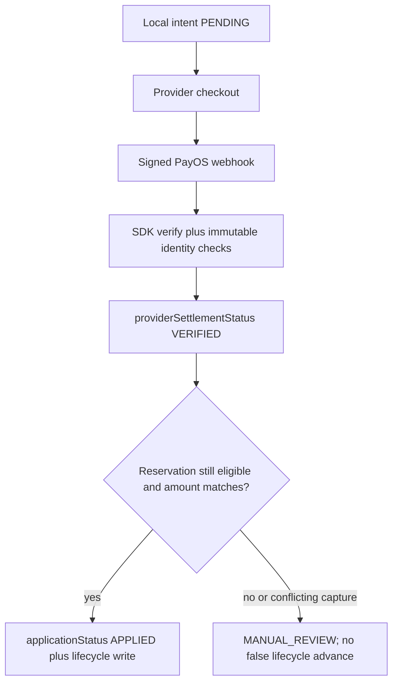

# Business workflows — current source and Frontend consequences

Source: local HEAD b7f09b4, compared with verified historical content 7a5cd84. Current evidence R01–R35 in [SOURCE_EVIDENCE](SOURCE_EVIDENCE.md); complete route/method references in [API_CHANGE_MATRIX](API_CHANGE_MATRIX.csv). No API executed. The arrows below represent verified service writes, not transitions inferred from enum names.

## Identity, registration and verification

Public POST `/users/register` receives email/password/displayName/optional phone and forces CUSTOMER; Keycloak provisioning then Mongo creation with compensation. Login POST `/auth/login` uses server-side confidential password grant and returns accessToken/refreshToken/user. Native can use Bearer without browser cookies. `requireAuth` verifies JWT via issuer/JWKS and loads active local User; role checks and resource ownership remain separate.

GET `/users/me`, PUT `/users/me/profile`, PUT `/users/me/password` remain; Customer identity profile GET/PUT `/customers/me/profile` and management verification are separate. GET profile may create missing profile; identity lock statuses do not cover every V2 phase. DisplayName/fullName inconsistencies remain. Registration sets provider emailVerified true; it does not establish a Customer email-verification interaction.

**No app refresh route added.** Logout still requires valid access token and passes refresh token to provider; access JWT immediate revocation/audience policy not established. Forgot-password limiter3/5min remains; OTP source entropy/TTL concerns unchanged. Native must not embed provider secrets or copy web local/sessionStorage. Session persistence/cancellation/cache partition/401 handling require an approved native design. Source gaps R04/R05/R29 are not repaired by a hidden button.

## Self Storage — discovery and booking

Old: exact Unit list without interval; create RESERVED → management approval → contract. Current:

```mermaid
flowchart LR
  A[Facility and exact Unit] --> B[UTC interval availability]
  B --> C[Server estimate and VERIFIED profile]
  C --> D[Create transaction: CONTRACTED plus DRAFT contract]
  D --> E[PayOS DEPOSIT pending]
  E --> F[Verified receipt applied: DEPOSIT_PAID]
  F --> G[Staff signed-paper proof: CHECKIN_READY]
  G --> H[PayOS BALANCE pending]
  H --> I[Verified receipt applied: PAID]
  I --> J[Staff handover: ACTIVE plus Unit OCCUPIED]
```

The last handover step is currently **dev/test-only**. Paper confirmation Self branch still lacks equivalent scope/state/transaction enforcement; the diagram describes intended actual branch writes, not production-safe release readiness. Generic Customer DRAFT signing currently does not check deposit stage in its Self fallback; website's `canSign` guard is stricter than server. No two-party hash certification is inferred for paper Self contracts.

- Exact Unit and Managed Cell identities must remain distinct.
- Unit list: optional paired parseable `startDate/endDate`, `availableOnly`; status/size/search/page/limit remain. Period rows include `isAvailableInRange`. Treat this as advisory until create lock/overlap recheck; operational and period status differ.
- Calendar: GET `/storage-units/:id/availability?month=YYYY-MM&startDate=YYYY-MM-DD&endDate=YYYY-MM-DD`. Month required; paired range optional, normalized UTC midnight, exclusive end. Returns storageUnitId/month/intervals/availabilityState/rangeAvailability/requestedRange/evaluatedAt. More than500 matched reservations gives UNKNOWN, never fabricate available.
- Shared overlap `[start,end)` includes committed DEPOSIT_PAID/CHECKIN_READY/PAID/ACTIVE/OVERDUE regardless hold expiry; temporary RESERVED/CONTRACTED only unexpired. A future interval can remain eligible for a Unit whose current physical status is HELD/OCCUPIED, while maintenance/inactive/facility restrictions still apply. Do not globally reject future periods from a physical status alone.
- Create body unchanged: `{facilityId,storageUnitId,startDate,endDate,pricingPolicyId}`; customerId derived from actor. Start is an instant strictly after now, not merely local date>=today. Server unit bookingVersion lock and transaction govern final availability. Verified identity reloaded in transaction before reservation/contract snapshots.
- Current success is `201 {success:true,data:reservation}` with status CONTRACTED. Contract not embedded as invented response field: retrieve safe contract endpoint.
- Overlap409 can return **top-level** suggestedUnits, max5, prioritizing same size then unitCode. Never automatically select/book an alternative or parse IDs from error prose. Missing suggestion array is valid and means no verified alternatives supplied.
- Pricing formula unchanged: ceil elapsed days; rent rounded days/30 × base; deposit half base for<30days else base. Policy lookup is not fully resource/term/effective-status bound; short-term credit can exceed total. Backend dependency R06 remains. Frontend must not silently substitute monthly fixture formulas.
- No idempotency contract for create: after transport/5xx uncertainty use owned list/detail reconciliation and user confirmation, not another automatic create.
- Cancel still owner Self + RESERVED/CONTRACTED; no implied refund. Approve/reject legacy routes remain for old RESERVED records. New CONTRACTED flow must not wait for routine approval or reapprove a newly created reservation.

Website already has SelfStorageReservationReview, strict selfStorageCreation, monthly availability/calendar tests and PayOS checkout. Preserve these; only missing suggestion rendering/lifecycle copy and release blockers require follow-up. Native04–06/09–12 still use illustrative pricing/status and require mapping.

## PayOS — Self only, three authoritative dimensions

New POST `/reservations/:id/payments/payos`: body **only** `{purpose:'DEPOSIT'|'BALANCE'}`, header `Idempotency-Key` trimmed nonempty length<=120, no CR/LF. Customer only, owner SELF_STORAGE reservation. No client amount, return URL or provider orderCode accepted. No If-Match required; server uses internal inventoryVersion CAS and immutable payment identity.

DEPOSIT: unexpired CONTRACTED + existing DRAFT contract; server computes credit. BALANCE: CHECKIN_READY + SIGNED paper contract with proof URL/publicId/verifiedAt + successful **APPLIED PAYOS DEPOSIT** matching immutable owner/facility/amount. Positive whole VND only. Zero balance returns409 `ZERO_BALANCE_REQUIRES_REVIEW`; **do not reuse Managed zero-balance completion**.

Intent/link split survives timeouts: transaction persists PENDING intent before provider create; checkout NOT_CREATED→CREATING→READY, UNKNOWN or RECONCILIATION_REQUIRED. Unresolved earlier attempt blocks another same-purpose attempt. Successful replay HTTP200 outcome REPLAYED; new link201 CREATED. On503 unknown commit/link retain exact key/purpose; don't mint another payment. One globally prefixed key binds owner/reservation/purpose/provider; key mismatch409. Payment model maintains unique successful reservation/purpose and provider reference indexes.

`status=SUCCEEDED`, `providerSettlementStatus=VERIFIED`, `applicationStatus=APPLIED` have different meanings. Verified late/wrong/conflicting money must remain recorded, may require MANUAL_REVIEW, and must not be labelled rental paid from provider success alone. Exact callback hashes support duplicate replay; distinct captures/non-success evidence require reconciliation. Callback signature/code/amount/link/currency and payment/reservation identity are checked. Unknown webhook commit returns503 for provider retry. Registration probe is a tightly matched signed sample and does not create a WDP settlement.

GET status is owner-scoped and can reconcile provider/checkout metadata; it is not a guaranteed side-effect-free operation. History GET under `/reservations/:id/payments/payos`: limit default10/max25, canonical base64url cursor ISO|ObjectId, stable descending createdAt/_id, data `{items,nextCursor}`. It is **not** all-service global payment history. Owner reads aren't disabled with checkout creation gate. No refund endpoint, Customer reconciliation command or general provider history API found.

Gate `PAYOS_ENABLED` controls create; keys stay server-side. Config checks Customer origin and webhook URL, production HTTPS. Both return/cancel URLs are server-built HTTP(S) **web** `/portal/payments/:reservationId`, not mobile custom-scheme/universal-link contract. Browser return is not verification. Native requires approved return design and authoritative state refresh on resume; never call webhook or accept URL success as paid.

## Managed reservations, contract and balance

V2 gate remains `NODE_ENV==='development' && MI_MANAGED_DEPOSIT_FLOW_ENABLED==='true'`. Quote/create outside gate may take legacy branch; do not treat PayOS addition as V2 production rollout.

```mermaid
flowchart LR
  A[Strict quote plus selected exclusive Cells] --> B[RESERVED plus HOLD]
  B --> C[Explicit Managed MOCK deposit confirmation]
  C --> D[DEPOSIT_PAID plus RESERVED allocations]
  D --> E[Register items and request first inbound]
  E --> F[Staff receiving inspection accepted]
  F --> G[Versioned contract generated]
  G --> H[Customer then Facility current-content signatures]
  H --> I[Managed balance confirmed or server zero balance]
  I --> J[CHECKIN_READY]
  J --> K[Staff physical first inbound: ACTIVE]
```

Term DAY/MONTH/YEAR uses UTC calendar math/clamping, full-term PER_M3 price × selected capacity and server deposit policy. Unique1..100 Cell IDs, exact capacity, current allocation/physical/operational eligibility and facility locks stay authoritative. Quote does not reserve; create revalidates. Self availability date-only shape is not the Managed exact UTC-Z map/booking shape.

Managed deposit/balance retain body idempotencyKey up to160 and same-key mock confirmation retries; no auto-confirm. Gate-disabled/expired hold cannot be repaired by frontend status change. Managed zero-balance is server-controlled and payment-free. PayOS new endpoints explicitly reject non-Self; no silent family fallback.

Managed contract snapshot/version/hash and Customer-before-Facility remain, but sign command has no reviewed hash/version input, and ensureVersion may update content during sign. Sign stays blocked for safe native release until compare-and-sign is defined. Partial signature remains DRAFT Backend status; derive presentation progress only from signatures matching current content. Fully signed state must suppress stale generic warning. Safe GET owner endpoints supported; raw print not safe.

Legacy Managed approval/paper/MOCK branches still exist. Managed paper now rejects V2 and checks assigned scope/preactivation/no closure with transaction and safe uploaded-asset cleanup/unknown-commit recovery. Do not replace V2 signatures with generic signed-paper action.

## Inventory, repeated inbound, stock, outbound and relocation

Registration body still requires managedReservationId, itemCode, name/category, positive safe integer quantity, quantityUnit, declared unitWeightKg/unitDimensionsM; description/preferredCell/images subject to validators. Mobile itemCode remains missing. REGISTERED quantity is not on-hand; images need real upload/ownership lifecycle, not fixture illustrations.

Every registration now serializes on reservation inventoryVersion before insertion and rechecks eligibility/facility in one transaction; every edit CASes Item and reservation even without images. REGISTERED/unplaced edit eligibility and rejected V2 correction exception remain. Closure marker blocks register/edit;409 refresh should preserve user form, not retry mutated data.

First singular inbound request remains separate from repeated plural request. First physical acceptance/confirmation and repeated receipt operations now share lifecycle fence. Pending closure blocks new receipt/amend/accept/stock confirmation; custody return/reject/cancel may remain necessary. Repeated create/amend gate production forced off; reads and cancel are separate. Return-completed removed creation gate, still Staff + scope + If-Match/key/state checks. Error503/unknown outcome requires same intent/version/key, not a fresh attempt.

Stock ledger/batch arithmetic files match baseline: schema/arithmetic policy, actual measurements, onHand/held/available reconciliation still authoritative. Missing projection/unknown lineage cannot become zero or Item.quantity. Movement history mixes legacy/canonical schema; preserve typed source/destination, ADD/REMOVE/MOVE semantics and actual totals/batch lines. No change to FIFO/custody/packing rules inferred from new closure token.

Canonical outbound create remains `{requestedQuantity}` only, header idempotency key; creates holds, no immediate stock withdrawal. Customer cancel uses If-Match+same intent key; no amend route. Staff physical confirmation can partially fulfill, releases unused hold and writes ledger; no Customer physical-confirm button. Closure **does not categorically block outbound** when current in-term ACTIVE conditions pass. Expired/OVERDUE operation remains denied absent separate controlled policy. Gates for requests/confirmation/ledger remain non-production opt-ins; never legacy fallback.

Relocation already exists: Staff-only legacy relocate and canonical context/command, not a new API in this diff. Canonical move validates current source, destination allocated Cell/facility hierarchy/geometry/capacity, reconciles ledger/holds, keeps stock quantity and moves physical counters/currentCell/movement atomically. It requires non-production canonical relocation+ledger gates and now no pending closure. Customer can view location/MOVE history; cannot relocate. Existing Staff screen is real UI but shared allowlist prevents HTTP until corrected.

## Closure and resource ownership

New GET readiness assesses an owned Managed reservation (Customer), assigned FM, ADMIN/BOM; **Staff excluded** by current roles. Mongo snapshot, bounded2000 Items; reconciles legacy/canonical movements, projections/batches/holds, pending requests/custody, allocations/counters/Rack capacity, contracts/payments. Nullable UNKNOWN is intentional; whole-Rack data unavailable must not be called verified.

Financial/disposition policy are unconditionally unresolved; overall readiness is UNKNOWN or BLOCKED. **No close/release action, zero-stock auto-close, final settlement/refund or quota release is implemented.** activeClosureRequestId is a fencing marker/schema field, not proof that a closure create workflow now exists. A future pending marker still blocks guarded inbound/metadata/relocation writes even if creation capability is disabled.

## Communications and role administration

Notification route/model unchanged: own list/mark-one; no typed destination/bulk read/count/push/socket. Support still has owner ticket/public conversation/reply, exact enum/length and singular relatedEntity; private reference ownership gap unchanged. Admin User CRUD, facility assignment, BOM facility/pricing/policy/warehouse/capacity and Staff/Manager service desk APIs remain mounted; no backend-diff-driven rewrite of stable CRUD justified. Support internal notes/assignment/admin fields must not leak into Customer mapping.

Staff CHECK_IN/handover are hardened and dev/test-only, but create/list inspections and CHECK_OUT remain insufficiently scoped/atomic (R02). Client `.filter(facility)` is not server authorization. Admin/BOM route role allowances do not override service assignment checks: e.g. handover requires assignedFacilityId even when route includes ADMIN. Keep demo records explicitly isolated; never present local checkout/refund as committed server state.

### Availability read-model nuance

`storage-unit.service.ts:186–190` annotates list `isAvailableInRange` only when operational status is AVAILABLE, while exact calendar `getUnitAvailability:89–92` excludes INACTIVE/MAINTENANCE and can report a future range AVAILABLE for a currently HELD/OCCUPIED Unit. These read models are not interchangeable. Calendar/range and final create checks must govern the existing future-booking UX; do not assume the list boolean and physical status encode one universal eligibility rule. Validate the discrepancy with Backend before choosing a shared mapper.
